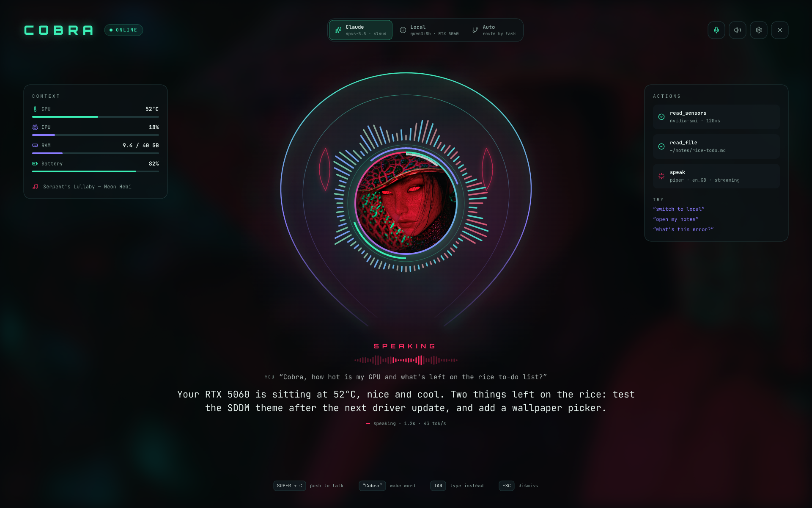
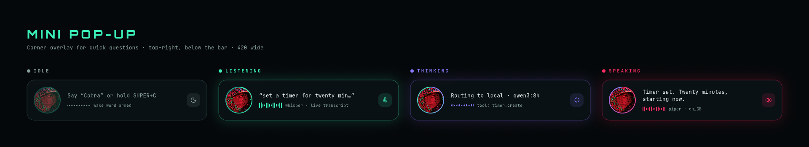

# 🐍 Cobra

A JARVIS-style voice assistant for the [Cobra Queen](https://github.com/wattsnathan01-boop/cobra-queen-dots)
Hyprland setup. She runs locally on your GPU through Ollama, can use your system through
tools, and asks before doing anything risky.



> **Status: milestone 6 of 7.** Voice (wake word or push-to-talk), the mini pop-up, the full
> HUD, system tools, files and shell commands behind confirm pop-ups, settings, and screen
> sharing all work. Memory and polish are next. See [PLAN.md](PLAN.md).

## Install (Arch)

```sh
git clone https://github.com/wattsnathan01-boop/cobra-ai.git ~/cobra-ai
cd ~/cobra-ai
bash install.sh
```

It installs Ollama (CUDA build), downloads `qwen3:8b` (~5 GB), the Whisper speech model
(~1.6 GB) and a Piper voice, sets up the `cobrad` service, links the Quickshell overlay to `~/.config/quickshell/cobra` and puts
`cobractl` on your path.

## Use

```sh
cobractl ask "how hot is my GPU?"
cobractl ask "put youtube on workspace 3"
cobractl chat          # back-and-forth; /reset to start fresh
cobractl status
```

### Voice

Add push-to-talk to the keybinds in `~/.config/hypr/hyprland.lua`:

```lua
hl.bind(mod .. " + C", hl.dsp.exec_cmd("~/.local/bin/cobractl listen start"))
hl.bind(mod .. " + C", hl.dsp.exec_cmd("~/.local/bin/cobractl listen stop"), { release = true })
```

Or just say **"Cobra, …"**: "Cobra, what's my GPU at?" works in one breath, and "Cobra" on its
own gets a "Yes?" and she waits for the question. The mic stays open for this; a voice
detector (Silero, on the CPU) cuts what it hears into phrases and Whisper checks whether each
starts with her name. Anything else is dropped without being kept or logged. Turn it off with
`cobractl wake off` (or `enabled = false` under `[wake]` in `config.toml`). She doesn't listen
for her name while she's talking, so use SUPER+C to interrupt her.

Hold SUPER+C, talk, let go. She answers out loud, starting as soon as her first sentence is
ready. Press SUPER+C while she's talking or thinking to cut her off and ask something else.
When she needs permission, hold SUPER+C and say "yes" or "no".

```sh
cobractl watch            # see what she hears and says, live
cobractl ask --say "hi"   # typed question, spoken answer
cobractl hush             # stop talking
```

### Mini pop-up



A Quickshell overlay in the top-right corner shows what she's doing: your words as you speak
(live transcript), the brain and tool while she thinks, and her words with voice bars while she
talks. It fades out a few seconds after she finishes. The button on the right cancels listening
or stops her talking. Start it with `qs -n -c cobra` (install.sh prints the Hyprland autostart
line and a blur rule).

### Full HUD

SUPER+SHIFT+C (or `cobractl hud`) opens the full HUD on the monitor you're using: her face in
the hood with a ring of bars that follows your voice and hers, live system stats and what's
playing on the left, the tools she just used on the right, and the conversation underneath.
TAB types a question instead of speaking; ESC closes it. Add the SUPER+SHIFT+C bind and the
`cobra-hud` blur rule that install.sh prints.

Speech-to-text is Whisper `large-v3-turbo` on the GPU; speech is Piper (`en_GB-cori-high`),
on the CPU. Both run locally. Change them under `[ears]` and `[voice]` in `config.toml`.

## What she can do so far

| Tool | Does | Permission |
|---|---|---|
| `system_stats` | CPU, RAM, temps, battery, GPU | always |
| `hypr_windows` | List open windows | always |
| `hypr_action` | Focus, move to workspace, switch workspace, fullscreen, float | always |
| `hypr_close` | Close a window | **ask** |
| `media` | Play/pause, next, previous, what's playing | always |
| `volume` / `brightness` | Get, set, up, down, mute | always |
| `apps_launch` | Open an installed app | always |
| `files_read` / `files_list` / `files_search` | Read, list and search files in allowed folders | always |
| `files_write` | Edit or create a file; you see the diff first, the old version is kept as `.bak` | **ask** |
| `shell_run` | Run a command as you; you see the exact command | **ask** |
| `sudo_run` | Run a command as root through `pkexec` (your password prompt) | **ask** |
| `files_delete` | Move a file to the trash | **never** |
| `screen_look` / `screen_watch` | Look at your screen with the local vision model | always |
| `memory_save` / `memory_forget` | Remember or forget a fact about you | always |

Change any of these in `~/.config/cobra/permissions.toml` (`always` / `ask` / `never`), along
with the `[files] allowed` folders. Paths are resolved for real (symlinks, `..`) before they're
checked, and Cobra's own config and logs, `~/.ssh`, keyrings and browser profiles are off-limits
even inside an allowed folder.

**Ask** shows a confirm card in the middle of the screen: **Y** allow once, **A** always (not
offered for commands), **N** or Esc deny, or just say "yes" / "no". No answer in 20 seconds
means no. Something set to **never** shows a "Blocked" card instead.
Every tool call is logged to `~/.local/state/cobra/audit.jsonl`.

## Claude

Cobra thinks locally by default. To add Claude (Opus 5.5 or Haiku 5.5), you need an Anthropic
API key; a claude.ai Pro/Max subscription doesn't include API access.

1. At [platform.claude.com](https://platform.claude.com): **Settings → Billing** to add credit
   (and a monthly limit if you like), then **Settings → API Keys → Create Key**.
2. Run `cobractl claude-key` and paste the key when asked. It isn't shown, it's checked with
   Anthropic, then stored **encrypted** as a systemd credential
   (`~/.config/credstore.encrypted/anthropic`), never in a plain file or the repo, and Cobra
   restarts. `cobractl claude-key --remove` forgets it.
3. Pick a mode in the HUD or **Settings → Brains**: **Local**, **Claude**, or **Auto**, which
   keeps quick things (media, volume, system info, windows, apps, memory, small talk) local and
   sends coding, files, explanations, writing and longer questions to Claude. "Ask Claude" /
   "use local" in a question always wins, and if Claude can't be reached she answers locally.

Your screen is always read by the local vision model, even when Claude answers. Settings →
Brains shows this month's spend.

## Screen

"Cobra, what's this error?" or "what does the terminal on the left say?": she takes a
screenshot of the monitor you're on (or just the focused window), and a local vision model
(`qwen3-vl:4b-instruct`) answers. If the answer is about one spot, she highlights it with a
note. "Watch my screen" keeps her looking whenever your question might be about it, until
you say "stop watching" or click the pill.

- **Nothing leaves the laptop.** Windows whose name or title contains a word on the hide list
  (password managers, banks) are blacked out before the model sees the frame. Edit the list
  under Settings → Permissions → Screen privacy.
- **You always know.** While she can see a screen there's a crimson edge round it, a "Cobra
  can see your screen" pill, and an eye badge in waybar.
- **Pointing is roughly right**, good for "this line" or "that button", not tiny targets.

## Other apps (MCP)

Cobra can use tools from other apps through MCP servers, such as [Pencil](https://pencil.dev)'s
design canvas. List them in `~/.config/cobra/mcp.json` (the usual `mcpServers` format) and
restart Cobra:

```json
{"mcpServers": {"pencil": {"command": "/home/you/.pencil/mcp/code_-_oss/out/mcp-server-linux-x64",
                           "args": ["--app", "code_-_oss", "--agent", "cobra"]}}}
```

Each app's tools appear as `<app>__<tool>` and go through the permission gate: tools the app
marks read-only run straight away, anything that changes things asks first (Settings →
Permissions → Connected apps). If the app isn't open she says so, and reconnects when it is.

## Memory

"Cobra, remember that I take my coffee black" saves it to `~/.config/cobra/memory.md` (a plain
list you can edit), and she knows it in every conversation from then on; "forget that…" removes
it. Conversations are saved to `~/.local/share/cobra/cobra.db`, so after a restart she carries
on where you left off (if it was within 6 hours; change it in Settings → Memory). Long
conversations are summarised in the background so she keeps the gist. `cobractl reset` starts a
fresh conversation.

## Settings

`cobractl settings` (or the gear in the HUD) opens the settings window: **Brains** (local
model, thinking on/off, VRAM), **Voice** (preview and switch voices), **Wake word** (on/off,
sensitivity, how long she waits after just "Cobra"), **Personality** (edit her persona), **Memory** (what she remembers, conversation history),
**Permissions** (always / ask / never per kind of action, allowed folders) and **Shortcuts**.
Every change is saved to the files below and applies immediately.

## Config

| File | What |
|---|---|
| `~/.config/cobra/config.toml` | Model, Ollama address, voice, limits |
| `~/.config/cobra/permissions.toml` | What she may do without asking |
| `~/.config/cobra/persona.md` | Her personality |

Logs: `journalctl --user -u cobra -f`

## Tests

```sh
python -m unittest discover -s tests -v
```
